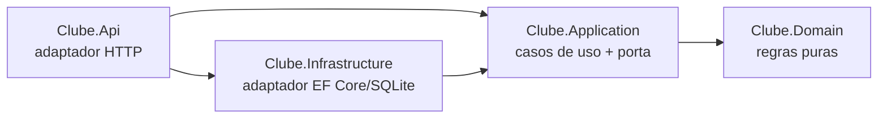

# clube-beneficios-dotnet

Clube de benefícios por assinatura em .NET 10 com arquitetura hexagonal: o membro assina com CPF, recebe 20 créditos por competência e troca créditos por recompensas.

## Camadas



| Projeto | Papel |
|---|---|
| `Clube.Domain` | `Membership`, `Cpf`, `Credits`, `BillingPeriod`, `Result<T>`. Sem dependência externa |
| `Clube.Application` | um caso de uso por classe e a porta `IMembershipRepository` |
| `Clube.Infrastructure` | `DbContext`, mapeamento dos value objects, repositório |
| `Clube.Api` | minimal API, composition root, erro de domínio para ProblemDetails |

## Decisões que valem a leitura

- **Crédito idempotente por competência:** reenviar a cobrança do mesmo mês não credita duas vezes, e uma competência fora de ordem é rejeitada.
- **Concorrência:** `Balance` é concurrency token, então dois resgates simultâneos geram 409 em vez de perder uma atualização.
- **Unicidade de CPF no banco:** o índice único é a fonte de verdade, sem pré-checagem que corre risco de race.
- **CPF mascarado** no `ToString` e na resposta, pra não vazar PII em log.
- **Validação na borda:** `RespectNullableAnnotations` faz o `cpf` nulo virar 400 antes de chegar ao domínio.

## Rodar

```bash
dotnet test
dotnet run --project src/Clube.Api
```

| Método | Rota | Corpo |
|---|---|---|
| POST | `/memberships` | `{ "cpf": "529.982.247-25" }` |
| GET | `/memberships/{id}` | |
| POST | `/memberships/{id}/allowance-credits` | `{ "period": "2026-10" }` |
| POST | `/memberships/{id}/redemptions` | `{ "rewardId": "cinema-ticket" }` |
