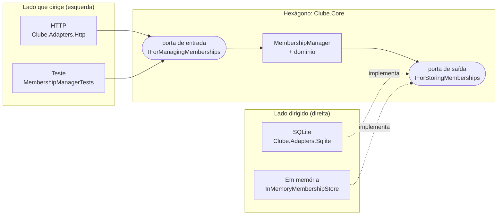

# clube-beneficios-dotnet

Clube de benefícios por assinatura em .NET 10 com **arquitetura hexagonal (ports and adapters)**: o membro assina com CPF, recebe 20 créditos por competência e troca créditos por recompensas.

> Leitura complementar: [Guia de C# para tech lead](docs/guia-tech-lead-csharp.md), com o ecossistema, boas práticas, pegadinhas e a avaliação honesta da linguagem.

## A ideia em uma frase

A aplicação mora dentro de um hexágono e não sabe que o mundo existe. Tudo que entra ou sai passa por uma **porta**, que é um contrato escrito pelo próprio hexágono, e cada tecnologia de fora se pluga numa porta através de um **adaptador**.

> "Allow an application to equally be driven by users, programs, automated test or batch scripts, and to be developed and tested in isolation from its eventual run-time devices and databases."
> Alistair Cockburn, [Hexagonal Architecture](https://alistair.cockburn.us/hexagonal-architecture/) (2005)



## O que é cada peça, neste repo

| Conceito | O que é | Aqui |
|---|---|---|
| **Hexágono** | regra de negócio e casos de uso. Não referencia nenhum framework | `src/Clube.Core` (zero pacote no csproj) |
| **Porta de entrada** (driving / primary port) | o que o mundo pode **pedir** ao hexágono | `Ports/Driving/IForManagingMemberships.cs` |
| **Porta de saída** (driven / secondary port) | o que o hexágono **precisa** do mundo, descrito nos termos dele | `Ports/Driven/IForStoringMemberships.cs` |
| **Adaptador de entrada** (driving adapter) | traduz uma tecnologia em chamadas na porta de entrada | `Clube.Adapters.Http` (HTTP para porta), `MembershipManagerTests` (teste para porta) |
| **Adaptador de saída** (driven adapter) | implementa a porta de saída com uma tecnologia concreta | `Clube.Adapters.Sqlite` (EF Core), `InMemoryMembershipStore` (teste) |
| **Configurador** | o único lugar que conhece tudo e pluga adaptador em porta | `src/Clube.Host/Program.cs` |

A direção da dependência é a regra que segura tudo: **adaptadores dependem do hexágono, nunca o contrário**. Quem define a interface de storage é o núcleo, não o EF. O `HexagonBoundaryTests` quebra o build se alguém fizer o `Clube.Core` referenciar ASP.NET, EF ou um adaptador.

### Lendo uma requisição de ponta a ponta

`POST /memberships/{id}/redemptions`

1. **Adaptador de entrada HTTP** (`MembershipEndpoints.Redeem`) lê o JSON, monta o `MembershipId` e chama `IForManagingMemberships.RedeemRewardAsync`.
2. **Hexágono** (`MembershipManager`) busca o membro pela porta de saída, aplica a regra (`Membership.Redeem`) e pede pra salvar.
3. **Adaptador de saída SQLite** (`SqliteMembershipStore`) faz o `UPDATE`, com o saldo como concurrency token.
4. O hexágono devolve um `Result<MembershipView>`, e o adaptador HTTP o traduz em 200 ou ProblemDetails (400, 404, 409 ou 422).

Trocar HTTP por gRPC ou fila, ou SQLite por Postgres, é escrever outro adaptador. O `Clube.Core` não muda uma linha.

### Por que existem dois adaptadores pra mesma porta

Uma porta só se paga quando tem mais de um adaptador. Aqui o segundo é o teste, exatamente como o Cockburn propõe: `MembershipManagerTests` dirige o hexágono pela porta de entrada com o `InMemoryMembershipStore` plugado na porta de saída. Roda em milissegundos, sem HTTP e sem banco. O `Clube.EndToEnd.Tests` cobre os adaptadores reais.

## Hexagonal x Clean Architecture

As duas buscam o mesmo isolamento, mas contam a história de jeitos diferentes.

| | Hexagonal | Clean |
|---|---|---|
| Metáfora | **dentro** x **fora**, com portas na borda | **camadas concêntricas** (entities, use cases, adapters, frameworks) |
| Vocabulário | port, adapter, driving, driven | entity, use case, interactor, gateway, presenter |
| Estrutura típica | `Core` + um projeto por adaptador | `Domain` / `Application` / `Infrastructure` / `Api` |
| Regra | adaptadores dependem das portas | dependências apontam pra dentro |

A primeira versão deste repo tinha a estrutura em camadas da Clean (`Domain/Application/Infrastructure/Api`) e só a porta de saída. Esta versão deixa porta e adaptador explícitos no nome, na pasta e no projeto.

O domínio fica numa pasta dentro do `Core`, não num projeto separado: no hexagonal a fronteira que importa é dentro x fora, não domínio x aplicação.

## Decisões que valem a leitura

- **Crédito idempotente por competência:** reenviar a cobrança do mesmo mês não credita duas vezes, e uma competência fora de ordem é rejeitada.
- **Concorrência:** `Balance` é concurrency token, então dois resgates simultâneos geram 409 em vez de perder uma atualização.
- **Unicidade de CPF na porta de saída:** quem garante é o índice único (ou o store em memória). Não há pré-checagem, que correria risco de race.
- **CPF mascarado** no `ToString` e na resposta, pra não vazar PII em log.
- **`TimeProvider` também é porta de saída:** o relógio já vem abstraído na BCL, com fake pra teste.

## Rodar

```bash
dotnet test
dotnet run --project src/Clube.Host
```

| Método | Rota | Corpo |
|---|---|---|
| POST | `/memberships` | `{ "cpf": "529.982.247-25" }` |
| GET | `/memberships/{id}` | |
| POST | `/memberships/{id}/allowance-credits` | `{ "period": "2026-10" }` |
| POST | `/memberships/{id}/redemptions` | `{ "rewardId": "cinema-ticket" }` |
